<a href="https://tosh.co.za/"></a>

  
  
  
  

 

I run **[The Only Software Hub](https://tosh.co.za/)**, a Johannesburg software studio, and write most of the code myself. Most of it is in private repos, so here's what's behind the green squares.

- 🏗️ **By day:** Rails and Python products for property, fintech, automotive and services businesses
- 🦀 **By night:** Rust and AI agents. A desktop AI that sees, hears and remembers, and an engine that fixes how your speakers sound
- 🇿🇦 **Always:** software built for South African problems, from conveyancing to car washes

 


  

## ⚡ Things I'm building

  <a href="https://tosh.co.za/"></a>
  <a href="https://tosh.co.za/"></a>
  <a href="https://bayline.tosh.co.za"></a>
  <a href="https://tosh.co.za/"></a>
  <a href="https://tosh.co.za/"></a>
  <a href="https://tosh.co.za/"></a>
  <a href="https://tosh.co.za/"></a>
  <a href="https://tosh.co.za/"></a>

<b>🧪 More from the workshop</b>

 

| Project | What it is | Stack |
|---|---|---|
| **Catch Up Zone** | Privacy-first proximity app that nudges you when a real contact is nearby. No feed, no strangers | FastAPI · Swift · Kotlin · Redis |
| **Talent Brew** | B2B marketplace matching benched professionals with firms that need their skills | Rails |
| **PropPass** | Property lifecycle platform *(in progress)* | Rails 8.1 · Postgres 18 |
| **VisitAr** | Visitor management with South African ID KYC and POPIA controls | Go |
| **Hotspot** | Community safety reporting with geofenced danger-zone alerts | Elixir |
| **BMSSP Engine** | Bounded multi-source shortest path: Rust core with Python domain adapters | Rust · Python · FastAPI |
| **ScamShield** | Real-time, multi-layer scam call protection | Dart |
| **Adaptive Cognitive Tutor** | Privacy-first adaptive learning platform | Python |
| **Nesbot CLI** | Homebrew-distributed CLI for [@NesloTechnologies](https://github.com/NesloTechnologies) | Ruby |
| **[pharmacy-formulary](https://github.com/counttalita/pharmacy-formulary)** | Temporal pharmacy formulary assessment | FastAPI · Postgres · Angular |

 

## 🛠️ Toolbox

   
   
  

 

## 📈 The climb


  

<picture>
  <source media="(prefers-color-scheme: dark)" srcset="https://raw.githubusercontent.com/counttalita/counttalita/output/snake-dark.svg" />
  <source media="(prefers-color-scheme: light)" srcset="https://raw.githubusercontent.com/counttalita/counttalita/output/snake-light.svg" />
  
</picture>

 

  Building from Johannesburg · <a href="https://tosh.co.za/">tosh.co.za</a> · <a href="https://github.com/We-Are-TOSH">@We-Are-TOSH</a> · <a href="https://github.com/Just-Be-Lekker">@Just-Be-Lekker</a> · <a href="https://github.com/NesloTechnologies">@NesloTechnologies</a>

